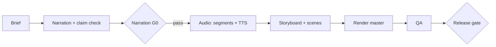

# Getting started

This is the guide to read after the bundle is installed in DSH. It is written for the agent that answers "how do I use this?" and for a person following along. Paths in `<angle brackets>` are placeholders; `<studio>` is the **Studio code root** printed at the top of every loaded skill.

## 0. Check what is already set up

```bash
node <studio>/scripts/studio-status.mjs [--data-root <dir>] [--json]
```

It prints the studio version, the code and data roots, the saved speech engine, voices, visual styles and every series with its episodes, then `Next:` with the missing setup steps in order. It changes nothing. Start here, do only the steps it lists, and run it again at the end.

## 1. Install

1. Node.js 20+ and FFmpeg on PATH; DSH `>=0.2.2-rc.1 <0.3.0`.
2. In the plugin checkout, `npm install` (Skia and MathJax).
3. Install the bundle: DSH Web **Plugins** page → local path of the checkout, or `plugin_manager` `action: install_bundle`. The profile then shows **Video studio presets**: the `video-producer` and `video-scene-worker` presets and nine `video-*` skills available in every session of the profile.
4. Run `node <studio>/scripts/preflight.mjs`. It reports the Skia engines, FFmpeg encoders, RAM/VRAM and whether the GPU is visible. Nothing is installed.

### GPU inside the DSH sandbox (optional)

DSH runs commands in a `bwrap` sandbox that hides GPU devices by default. If preflight reports the GPU as `hidden-by-sandbox`, follow [GPU inside the DSH sandbox](dsh.md#gpu-inside-the-dsh-sandbox): add the `scripts/dsh-gpu-sandbox` runner to `$DSH_HOME/cordis.patch.yml`, restart DSH, and re-run preflight from a DSH session. Read its security note first. Without a GPU, rendering still works on the CPU; GPU speech synthesis does not, and it never falls back to the CPU silently.

## 2. Choose the workspace (data root)

Projects, the library, voices and caches live in the **data root**, separate from the plugin code. By default it is the DSH session's working directory (or the nearest ancestor that already holds `library/catalog.json`). To keep one studio for all sessions, open sessions in the same directory or set it explicitly:

```bash
node <studio>/scripts/init-workspace.mjs --data-root /path/to/video-workspace
```

Initialization is idempotent and never overwrites files. Creating the first episode also initializes the workspace.

## 3. Speech: engine once, voice once

Skip this section for `silent` or `text-only` videos.

**Engine (once per machine).** Point the studio at the TTS environment and let it prove a real sample:

```bash
node <studio>/scripts/setup-tts.mjs --python /path/to/venv/bin/python --model /path/to/OmniVoice-checkpoint \
  --voice-reference take.wav --ref-text "exact words in take.wav" --require-gpu \
  [--env HF_HOME=/path/to/hf-cache --env HF_HUB_OFFLINE=1]
```

On a passing sample it writes `<dataRoot>/tts.config.json` (interpreter, model, provider command, environment, and what was verified). Every audio command then reads it, so later commands need no paths. A failing run writes nothing and prints the reasons. `--show` prints the saved runtime. Re-run it after moving the model or changing the environment.

**Voice (once per narrator).** A voice is a package: a clean 3–30 s recording, its exact transcript and a rights note.

```bash
node <studio>/scripts/new-voice.mjs narrator --reference take.wav \
  --ref-text "exact words in take.wav" --rights "who is speaking and how it may be used"
node <studio>/scripts/audio-preflight.mjs --voice-package narrator --synthesize-sample
```

Listen to the sample it reports. Then select the voice for a whole series in `projects/<series>/project.json`, or for one episode in its `production.json`:

```json
{ "voicePackage": "narrator" }
```

There is no default voice. A narrated episode without a selected voice stops before synthesis. Details: [library/voices/README.md](../library/voices/README.md).

## 4. Look (optional)

Scenes take colours, fonts and layout from a **visual style**. The built-in `default` works out of the box. To give a series its own look:

```bash
node <studio>/scripts/new-visual-style.mjs <id> --from default
```

Edit `library/visual-styles/<id>/style.json`, and set `"visualStyle": "<id>"` in `project.json`. To start from a reference video or screenshots, add them with `extract-style-refs.mjs` after creating the style. Details: [library/visual-styles/README.md](../library/visual-styles/README.md).

## 5. Make a video

Open a session with the **video-producer** preset in the data root and describe the video in plain language. For example:

```text
/video-produce
Make a 6-minute narrated Vietnamese episode for the "software-architecture" series,
episode ep-804, about the circuit breaker pattern, from sources/brief-8.4.md.
Use the series voice and style. Deliver a 1080p master.
```

The producer works through the stages below and stops at a gate when something is missing or wrong, naming the blocker:



- **Narration G0:** the script is reviewed with evidence before any speech or scene work. If it is blocked, fix the named claims; the producer revises with `revise-narration.mjs`.
- **Audio:** synthesized with the selected voice on the verified engine. Unchanged segments are reused on reruns.
- **Scenes:** reused templates first, then copied scenes, then new code with at most two parallel scene workers.
- **Render:** `render-episode.mjs` renders scenes in parallel, caches them and normalizes loudness. A released master is never overwritten; new cuts go to a new path.
- **Release:** `validate-episode.mjs <episode> --release` must print `PASS`. A fresh episode is `INCOMPLETE`, not delivered.

Outputs are in `projects/<series>/episodes/<episode>/`: `exports/` (master), `qa/` (evidence), `audio/`, `scenes/`, `reports/`.

## Common requests

| Goal | Ask the producer, or run |
|---|---|
| Write or review only the script | `/video-narration` "Write the narration for ep-804; do not synthesize" |
| Change a paragraph after review | `/video-narration` "Revise section 3: …; report what became stale" |
| Re-voice with another narrator | set `voicePackage`, then `/video-audio` "re-synthesize ep-804" |
| Restyle a series | set `visualStyle`, then "re-render ep-804 to exports/master-v2.mp4" |
| Silent or text-only short | `/video-produce` "… no voice-over; mode silent" |
| QA an existing master | `/video-qa` "Review exports/master.mp4 and the release status" |
| Measured time and token use | `node <studio>/scripts/collect-metrics.mjs --episode <episode-dir> --json` |

More prompts: [examples.md](examples.md).

## When something stops

| Message | Meaning and fix |
|---|---|
| `no voice selected` | Set `voicePackage` on the series or episode (step 3). |
| `tts.config.json is invalid` / engine paths missing | Re-run `setup-tts.mjs`. |
| `GPU is hidden by the sandbox` | Configure the DSH GPU runner (step 1). |
| `refusing CPU fallback` | The GPU was required but not verified; fix the GPU, do not drop `--require-gpu` for OmniVoice. |
| `segments are stale relative to narration.md` | The script changed; re-segment before synthesis. |
| Release `INCOMPLETE` / `FAIL` | Read `release.errors` and `release.missing`; each names the artifact or gate to fix. |

Reference material: [README.md](../README.md) (all commands and contracts), [architecture.md](architecture.md), [dsh.md](dsh.md), and the standing rules in [AGENTS.md](../AGENTS.md).
